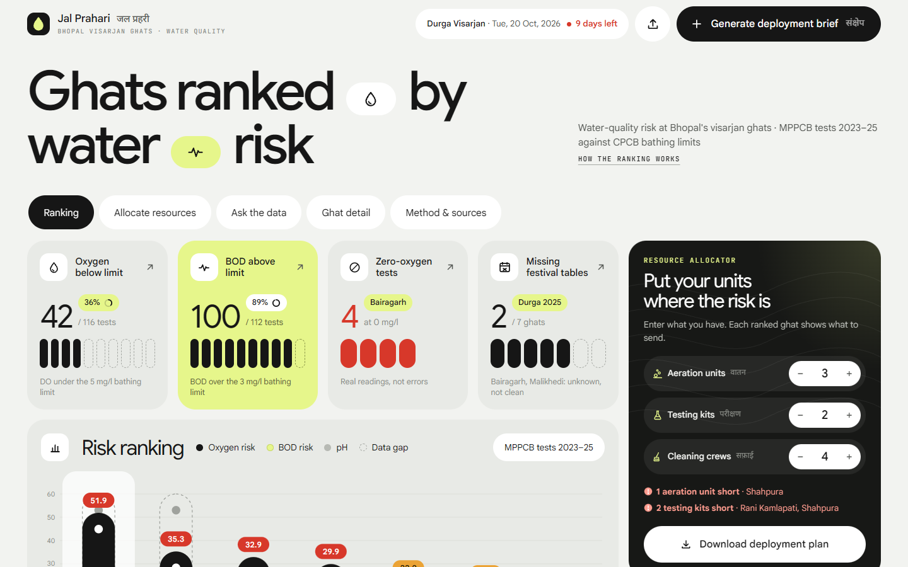
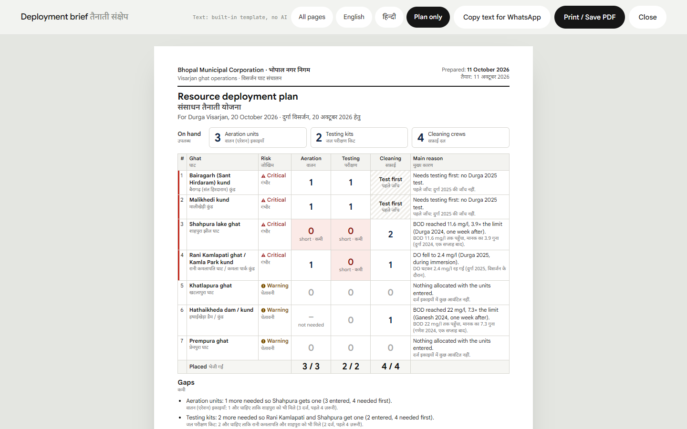
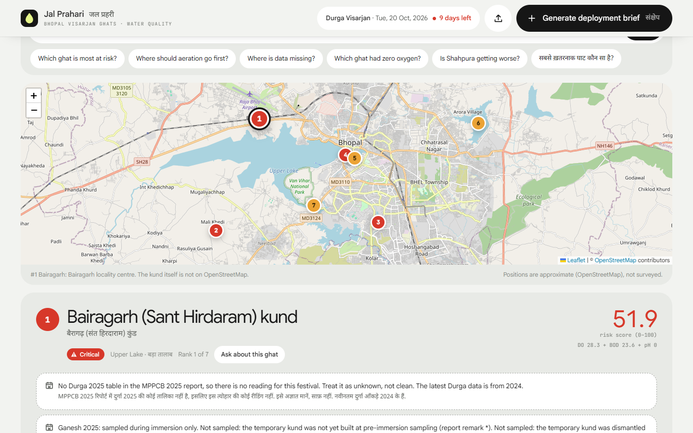
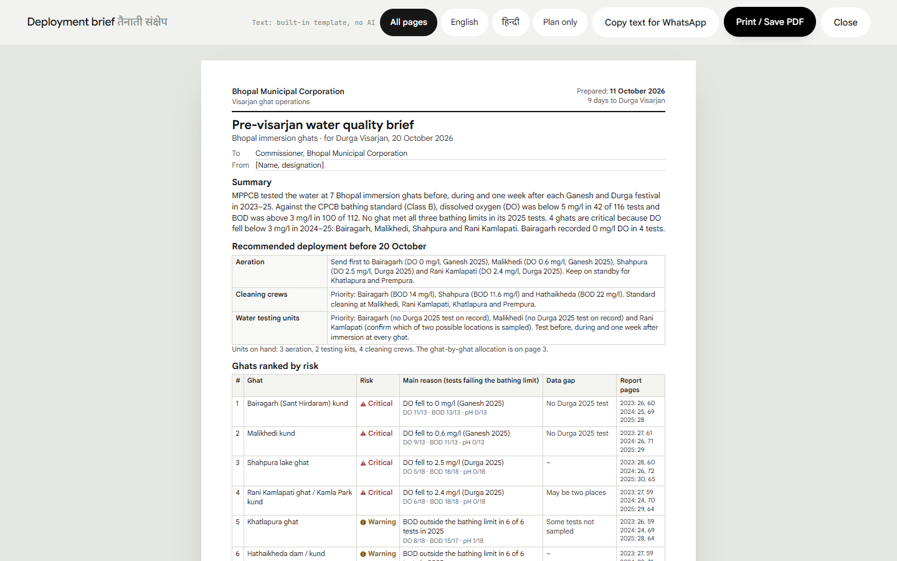

# Jal Prahari (जल प्रहरी)

**Water-quality risk at Bhopal's visarjan ghats, ready before Durga Visarjan on 20 October 2026.**

Three years of MPPCB water tests (2023–25), lined up against the CPCB bathing limits, ranked, explained in plain English and Hindi, and traceable to the exact page of the report.

| | |
|---|---|
| **Track** | 2: Visarjan Ghat Watch (Claude Impact Lab × Cerebras, Bhopal, 11 Oct 2026) |
| **Team** | Lohit Sai Ganta |
| **Members** | Lohit Sai Ganta (@Yu-369) |
| **The one user** | The Bhopal Municipal Corporation officer who plans Durga visarjan at the ghats and decides where to send extra cleaning crews, aeration and water-testing units. Today that decision rests on memory, because the results sit in 90–120 page PDFs. |



## What the officer gets

1. **A ranked list of the 7 ghats**, with the reason for each rank in plain words: Critical (red), Warning (amber), Within limits (green), No data (grey). Every colour comes with an icon and a label.
2. **Click any ghat** to see:
   - why it ranks there
   - what to deploy (aeration, cleaning crew, testing unit)
   - 3-year trend charts against the limit
   - every bathing-limit violation
   - all of its readings (192–228 per ghat)

   Click any number to open the MPPCB PDF at that page.
3. **One button: the deployment brief.** One A4 page in English and one in Hindi, ready to print, save as PDF, or copy as text for WhatsApp. The To/From lines are editable.
4. **A Q&A bar** that answers in English or Hindi ("Where should aeration go first?", "सबसे ख़तरनाक घाट कौन सा है?"). It cites the report page for every number and shows its response time.
5. **A map** of the 7 ghats as numbered, colour-coded markers (OpenStreetMap).
6. **Upload new report**: load next year's readings CSV, and the ranking, brief and Q&A update. See [Updating the data each year](#updating-the-data-each-year).
7. **Resource allocator**: enter the aeration units, testing kits and cleaning crews you actually have. Every ranked ghat instantly shows what to send, and **Download deployment plan** prints a one-page bilingual plan with an approval line, also included as page 3 of the brief. See [Resource allocator](#resource-allocator).







## Run it (4 steps)

1. Install [Node.js](https://nodejs.org) 22.9 or newer.
2. In this folder, run `npm install`.
3. Run `npm start`.
4. Open <http://127.0.0.1:3000>.

No API key is needed. Everything above works offline except the map tiles and web fonts. AI is optional (see below).

Run the tests with `npm test` (38 tests covering the data rules, Q&A citations, the brief, the AI safety checks, uploads and the resource allocator).

## Results (from the data, not from AI)

- Dissolved oxygen (DO) was below the 5 mg/l bathing limit in **42 of 116** tests. BOD was above 3 mg/l in **100 of 112**.
- **No ghat met all three bathing limits in its 2025 tests**, so no ghat is shown green.
- **4 critical ghats**, where DO fell below 3 mg/l in 2024–25: Bairagarh (0 mg/l), Malikhedi (0.6), Shahpura (2.5, Durga 2025) and Rani Kamlapati (2.4, Durga 2025).
- Bairagarh recorded **DO = 0 mg/l in 4 tests**: 2023 report p.26 and p.60 (twice), 2025 report p.28.
- **Bairagarh and Malikhedi have no Durga 2025 test.** That is unknown, not clean, so the tool sends testing units there as a priority.

## Resource allocator

Enter the units on hand (they're remembered on that computer). The tool then decides where each one goes, with arithmetic in code (`shared/allocate.js`). The browser, the printed plan and the tests all run that same code.

1. **Units only go where the data shows a need.**
   - Aeration goes where DO fell below 5 mg/l in the last two years. Hathaikheda never gets one, because its oxygen was always fine.
   - Cleaning crews go where BOD broke the bathing limit.
   - Testing kits can go to any ghat.
2. **Each critical ghat gets one first.**
   - Testing kits go first to ghats that need testing, then to the uncertain Rani Kamlapati site, then to the other critical ghats.
   - Every ghat gets a testing kit before any gets a second.
3. **The rest are shared in proportion to risk, specifically the risk that resource fixes.**
   - Aeration follows the oxygen part of the score, cleaning the BOD part, and testing the whole score (largest-remainder rounding).
   - This is why Hathaikheda, with the worst BOD in the data (22 mg/l), gets a cleaning crew even though its overall rank is 6.
4. **Ghats with insufficient data need testing first.** That means the latest Durga test is missing, or fewer than 75% of DO and BOD tests are on record (today: Bairagarh, Malikhedi). They get a testing kit, and their cleaning crew is held back until they're tested.
5. **Shortfalls are stated, not hidden.** If there are fewer units than critical ghats, the tool names the ghats left out and how many more units are needed. Example: "1 aeration unit short · Shahpura".

With 3 aeration units, 2 testing kits and 4 cleaning crews (the defaults):
- **Aeration** goes to Bairagarh, Malikhedi and Rani Kamlapati, the three worst oxygen records.
- **Testing kits** go to Bairagarh and Malikhedi.
- **Cleaning crews:** Shahpura gets 2, and Rani Kamlapati and Hathaikheda get 1 each.
- **Shortfall:** 1 aeration unit (Shahpura) and 2 testing kits (Rani Kamlapati, Shahpura).

## Updating the data each year

When MPPCB publishes a new Ganesh and Durga Visarjan report:

1. Click **Download CSV** (footer) to get the data in use, or start from `data/bhopal_ghats_2023_2025.csv`. Add the new year's rows in the same columns. In Excel, use File → Save As → CSV UTF-8.
2. Click **Upload new report** (top right) and choose the file. The dashboard reloads with the risk scores recomputed.
3. Optional: save the new report PDF as `public/reports/mppcb_visarjan_report_<year>.pdf` and restart. The page links for that year then open the PDF. Without it, page numbers still show but cannot be clicked.
4. Set `VISARJAN_DATE` in `.env` to the next visarjan date.

**How it works:**

- **Years in the file replace those years; every other year is kept.** A file with only 2026 rows adds 2026. A corrected 2025 file fixes 2025. Re-uploading the full file replaces everything.
- **All-or-nothing check, in code.** The file must have the same columns, the 7 standard ghat names, known parameters, numbers or empty values, and a page number on every row. Any problem rejects the whole file, with line numbers, and the dashboard keeps the previous data.
- **Where it's stored:** merged data goes to `data/readings_current.csv` and the version before it to `data/readings_previous.csv`. The data-pack file is never modified. To go back to the original data, delete `data/readings_current.csv` and restart.
- **3-year window:** ranking, trends and the brief use the three most recent years, so with 2026 loaded the tool shows 2024–26. Weights and wording ("Critical if DO fell below 3 mg/l in 2025–26", "No Durga 2026 test") follow the data. A festival whose report is not out yet is left off, not flagged as missing.
- **New ghats:** a site name the tool doesn't know is rejected. Add the ghat (name, Hindi name, map position) to `GHATS` in `lib/dataset.js` first.

Uploads are only reachable from the computer running the tool unless `HOST` is changed. If you open it to the office network, anyone on that network can upload.

## How the ranking works

All of this is in [`lib/risk.js`](lib/risk.js) and shown on screen under "How the ranking works".

- **Which CPCB class:** Class B (outdoor bathing, organised). People bathe and take holy dips at these ghats during visarjan. Limits come from `data/cpcb_water_quality_criteria.csv`: **DO ≥ 5 mg/l, BOD ≤ 3 mg/l, pH 6.5–8.5.**
- **What counts:** only those three parameters. COD, solids, turbidity, conductivity and the four metals have no Class B limit, so they are shown for information and never affect the score.
- **Severity of a failing test:** from 0.25 (just over the line) to 1 (DO at 0, BOD at 12+ mg/l, pH 1.5 units out). Passing tests score 0.
- **Weights:** recent tests count more (2025 ×3, 2024 ×2, 2023 ×1). Durga tests count 1.5×, because the next event is Durga.
- **Score** = 100 × (0.50 × DO severity + 0.35 × BOD severity + 0.15 × pH severity). It is averaged over the tests that were actually done.
- **Tier first, then score:**
  - **Critical:** DO fell below 3 mg/l in any 2024–25 test.
  - **Warning:** a bathing limit was broken in the two latest festivals tested.
- **Deployment rules:**
  - **Aeration:** priority if DO fell below 3 mg/l in 2024–25; standby if it fell below 5.
  - **Cleaning crew:** priority if BOD went above 9 mg/l (3× the limit) in 2024–25.
  - **Testing unit:** priority where data is missing or the site is uncertain.

## The hard cases, and how they are handled

| Case | Treatment |
|---|---|
| `BDL` (below detection limit) | Very low: **not zero and not missing**. It passes a maximum limit, fails a minimum limit, and is "unknown" against a range. No DO, BOD or pH reading is BDL, so BDL never changes the ranking. |
| Blank, `_`, `*`, `**` | **Missing: unknown, never clean.** Missing tests are left out of the score average (they are never counted as passes), shown hatched grey everywhere, and explained. `*` and `**` quote the 2025 report remark: the temporary kund was not yet built / already dismantled. |
| DO = 0.0 | A real, catastrophic reading, not an error. It gets the maximum severity. |
| Rani Kamlapati / Kamla Park | Flagged "may be two places" (medium match confidence). Ganesh tables print "Kamla Park kund", Durga tables print "Lower Lake ghat". The testing unit is asked to confirm which place is sampled. |
| Bairagarh, Malikhedi: no Durga 2025 table | Shown as "No table: unknown, not clean" on the cards, charts, tables and brief. Testing is set to priority. |
| Trends | Uses the worst reading per festival-year, each one a real reading with a page. A series that is still failing is never called "better" (for example, Bairagarh's Durga DO going from 0 to 2.2). |
| Suspicious values | 2025 Ganesh lead reads exactly 0.031 and chromium exactly 0.03 at every ghat and phase. This is flagged as a possible reporting limit, not a measurement. The check is computed from the data, not hard-coded. |
| Health effects | None claimed. Readings are reported against CPCB limits only. |

**Traceability:**
- Every reading carries its report year, PDF page and CSV row.
- `source_page` is the physical PDF page (checked with `pdftotext`), so links open `reports/<file>.pdf#page=N`.
- The three MPPCB reports are bundled in `public/reports/` so the links work offline.

## AI is optional and off by default

The department can choose a provider later. In `.env` (copy from `.env.example`), set a provider per role:

| Role | Used for | Suggested |
|---|---|---|
| `FAST_AI_PROVIDER` | Q&A bar and per-ghat summaries | `cerebras` (`llama-4-scout-17b-16e-instruct`), for very low latency |
| `WRITER_AI_PROVIDER` | Wording of the brief in English and natural Hindi | `anthropic` (`claude-opus-5-5`) |

**Guarantees that hold with any provider:**
- AI never parses data, checks limits or ranks ghats. That is all code.
- AI receives a fact sheet built in code, and must cite `[table-id]` for each number. Citations that don't exist are removed.
- **Every number in an AI answer is checked against the fact sheet.** The UI shows "All 6 numbers match the source data", or names the number it could not find.
- In the brief, any AI-written field containing a number not in the facts is thrown away and replaced by the built-in template text. Tables are always generated by code.
- If the AI call fails, the built-in answer is shown with a notice.

## What works and what doesn't (honest)

**Works today**
- Ranking, reasons (EN + HI), deployment suggestions, data-gap flags, trend charts, violation lists and full readings, all page-linked.
- Built-in Q&A for the questions an officer is likely to ask: risk ranking, where to deploy, missing data, zero oxygen, trends, comparisons, a ghat, a parameter, BDL, metals, and limit violations. It answers in English or Hindi.
- The bilingual brief: 2 × A4, print / save PDF / copy for WhatsApp.
- "Upload new report" with validation, merge-by-year and a moving 3-year window, tested with synthetic 2026 data.
- Resource allocator with instant recalculation, shortfall warnings and a printable bilingual plan.
- 38 automated tests.

**Limits and not done**
- **AI path is not tested against live providers.** No API keys were used during the build. It is tested against a local mock endpoint (`test/ai-plumbing.test.js`); choosing and testing a provider is left to the department.
- The built-in Q&A recognises common question types. Unusual phrasing gets a summary and suggestions, not a free-form answer.
- **Map positions are approximate.** They come from OpenStreetMap, not a survey:
  - Prempura ghat, Hataikheda dam and Shahpura Lake are mapped features.
  - Bairagarh, Malikhedi (Malikheri village) and Rani Kamlapati (Kamla Park) are placed at the locality.
  - Khatlapura is placed at the Lower Lake centre.
- **Total coliform** is part of the bathing standard but is not measured in these reports, so bacterial safety cannot be judged.
- The data has three tests per festival, which is a snapshot rather than continuous monitoring. Units are assumed, because the reports print none.
- The NGT has banned immersion in the Upper and Lower Lakes. These readings describe the sites used in 2023–25, not BMC's new ghats.
- The statewide file (`mp_immersion_sites_2023_2025.csv`) and the lake monitoring PDFs are not used.
- The interface chrome is in English. Reasons, notes, the brief and Q&A answers are bilingual.

## Design

The dashboard uses a soft-grey dashboard style: large rounded cards, black pill buttons and one lime accent.

- **Heading:** "Ghats ranked by water risk", with icon pills between the words.
- **Navigation:** section tabs jump to Ranking, Allocate resources, Ask the data, Ghat detail and Method & sources.
- **Primary action:** the black "Generate deployment brief" pill sits in the sticky top bar, so it is always one click away. The round button beside it uploads a new report.
- **Stat cards:** each shows a big number with its denominator, a "%" pill, and capsule bars. A solid capsule is counted; a dashed capsule is missing or not counted.
- **Risk ranking card:**
  - **Score chart:** a stacked-capsule chart of each ghat's risk score (lime BOD risk, black oxygen risk, grey pH). A score pill in the tier colour sits on top, and ghats with a data gap get a dashed "unknown" extension.
  - **Ranked rows:** each row shows the reason, data gaps, test strip and the units to send.
- **Sidebar:**
  - The resource allocator, as a dark card.
  - Quick-question cards that open the Q&A.
  - Download-data and method tiles.
- **Trend charts:** one capsule per test. Black meets the bathing limit, red breaks it, and a dashed capsule means not sampled (unknown, never clean).
- **Colour:** lime is the brand accent only. Risk keeps its own colours (red critical, amber warning, green within limits, grey no data), always paired with an icon and a word.
- **The visual layer is separate from the app:**
  - `public/ui.css` is the visual layer, loaded after `public/styles.css`.
  - `public/js/gold.js` handles visual behaviour only: tab highlighting, scroll reveal, and scrolling to the detail when a ranked ghat is clicked.
  - Removing the `ui.css` link falls back to the plain base styles.
- **Built for weak hardware:** no backdrop blur, full-screen textures or endless animations. Old office PCs and remote-desktop sessions render without a GPU, and those effects made scrolling stutter there.

## Data used

| Data | Source |
|---|---|
| Readings: 1,524 rows, 7 ghats, 2023–25 | `data/bhopal_ghats_2023_2025.csv`, from the track data pack, extracted from the MPPCB reports |
| CPCB limits | `data/cpcb_water_quality_criteria.csv`, from the track data pack ([CPCB](https://cpcb.gov.in/water-quality-criteria/)) |
| MPPCB reports (bundled for page links) | [2023](https://www.mppcb.mp.gov.in/proc/mon/Idol_immer._Report_23_CPCB.pdf) · [2024](https://www.mppcb.mp.gov.in/proc/mon/Ganesh_and_Durga_visarjan_report-2024.pdf) · [2025](https://www.mppcb.mp.gov.in/proc/mon/Ganesh_and_Durga_visarjan_report-2025.pdf) |
| **Extra:** ghat positions | [OpenStreetMap](https://www.openstreetmap.org/copyright) via Nominatim / Overpass, looked up 11 Oct 2026 (© OpenStreetMap contributors, ODbL) |
| **Extra:** map tiles | OpenStreetMap standard tiles |
| **Extra:** fonts | Google Sans and Noto Sans Devanagari via Google Fonts |

No personal data. No live government system is contacted. The app only links to the public MPPCB PDFs.

## Project layout

```
server.js            Express server + JSON API (/api/model, /api/ask, /api/summary/:id, /api/brief, /api/upload, /api/data.csv)
lib/dataset.js       CSV -> typed readings (measured / bdl / missing), ghats, reports, map positions
lib/limits.js        CPCB rules from the criteria CSV; pass/fail/missing checks
lib/risk.js          scoring, tiers, reasons (EN+HI), data-gap notes, deployment, trends
lib/model.js         builds the single model + headline numbers + data caveats
lib/qa.js            built-in bilingual Q&A engine (no AI)
lib/grounding.js     entity extraction, AI fact sheets, number verification
lib/llm.js           optional AI adapters (Cerebras, Anthropic), off unless configured
lib/ask.js           Q&A + summaries: built-in by default, AI with verification if enabled
lib/brief.js         brief facts, bilingual template, optional AI rewording with checks
lib/upload.js        upload validation, merge by year, save with backup
shared/allocate.js   resource allocator (pure; used by the browser, the printed plan and the tests)
public/              dashboard (vanilla JS modules, Leaflet, hand-built SVG charts, print CSS)
public/ui.css        visual layer (cards, pills, capsule charts, motion); remove to revert
public/js/gold.js    visual-only behaviour (tabs, scroll reveal, scroll to detail)
public/js/scorechart.js  risk-score capsule chart in the ranking card
public/js/allocator.js  allocator inputs, per-ghat send column, detail panel sync
public/reports/      the three MPPCB PDFs, for page links
test/                node:test suites
```

## License

[MIT](LICENSE). Offered to the Government of Madhya Pradesh through MPSeDC.
